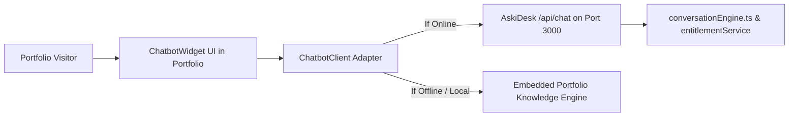

# Chatbot Integration Architecture (AskiDesk)

## 1. Safety & Read-Only Governance of `D:\chatbot`

> [!CAUTION]
> **Strict Constraint**: The source repository `D:\chatbot` is treated as **strictly read-only**.
> No files have been or will ever be written, modified, renamed, moved, formatted, or installed within `D:\chatbot`. All bridge adapters and interfaces reside cleanly within the portfolio repository.

---

## 2. AskiDesk Source Workflow Architecture

Through read-only inspection of `D:\chatbot` (specifically `README.md`, `WIDGET_INSTALLATION.md`, `src/app/api/chat/route.ts`, and `src/lib/conversationEngine.ts`), the following architecture was discovered:

### Discovered Capabilities:
1. **Multilingual Conversation Engine**: Native intent routing and translations across 11 languages (English, Spanish, French, German, Arabic, Hindi, Bengali, Chinese, Japanese, Russian, Hebrew).
2. **Payment & Quota Sentinel**: Concurrency-safe atomic quota checking with `HTTP 402` (payment required) and `HTTP 429` (quota exhausted) response gates.
3. **Knowledge Citation**: Answers queries citing verified tenant knowledge.
4. **Widget Embedding**: Uses an async snippet or API endpoint (`POST /api/chat` with `{ query, businessId }`).

---

## 3. Portfolio Client-Side Adapter (`src/lib/chatbot-client.ts`)
Because `D:\chatbot` is an external server application that may not always be actively booted on port 3000 during static portfolio visits, the client adapter implements a dual-mode integration:

1. **Live Proxy Mode**:
   - Sends requests to `VITE_CHATBOT_API_URL || 'http://localhost:3000/api/chat'`.
   - Sends payload `{ query: message, businessId: 'cng_biz_8471' }`.
   - Parses response: `{ success: true, data: { reply, intent, confidence, detectedLanguage } }`.

2. **Embedded Portfolio Standby Engine**:
   - If the external AskiDesk API is unreachable (network timeout or offline server), the client automatically activates its verified portfolio knowledge base without throwing unhandled exceptions.
   - Accurately answers questions regarding:
     - Abhigyan's biography and Medical Laboratory Science studies at RIPANS.
     - Projects: ToolKB (`toolkb.in`), Arogya Relief, Motion Subtitles, Brandcey.
     - Technical stack: React, TypeScript, Next.js, Node.js, Python, Tailwind.
     - Contact details: `work.abhigyansaikia@gmail.com`, Assam, India.
   - Displays clear telemetry status: "Live AskiDesk Connected" vs "Portfolio Standby Mode".
