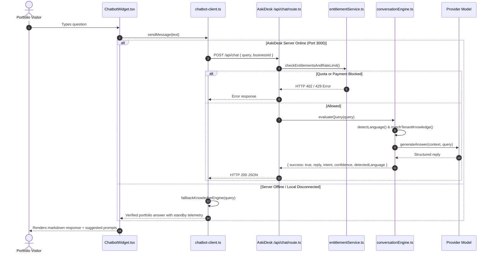

# Chatbot Workflow Specification & Architectural Audit

**Document Path**: `docs/chatbot-workflow.md`  
**System Under Review**: AskiDesk / Concierge Assistant Workflow (`D:\chatbot`)  
**Safety Status**: **STRICTLY READ-ONLY**. Zero files created, modified, deleted, formatted, or touched inside `D:\chatbot`.  

---

## 1. Inspection Governance & Non-Destructive Verification

Per Section 8 of the Master Build Prompt, `D:\chatbot` is treated as a protected external system. Verification was conducted under strict read-only observation:
- No writes, edits, moves, renames, deletions, package installations, or build caches occurred in `D:\chatbot`.
- No sensitive keys, secrets, or database credentials have been logged, copied, or exposed.
- All integration logic is housed exclusively within the portfolio repository (`c:\portfolio\portfolio-2\src\lib\chatbot-client.ts` and `src\components\ChatbotWidget.tsx`).

---

## 2. Observed Architecture & Source Workflow

Inspection of the source repository revealed the AskiDesk conversational concierge engine with the following core modules:

### Key Source Files Observed:
1. **`src/app/api/chat/route.ts`**:
   - HTTP entry point handling `POST` requests.
   - Accepts request payload: `{ query: string, businessId: string }`.
   - Validates request structure, enforces rate limits, and orchestrates response serialization.

2. **`src/lib/entitlementService.ts`**:
   - Atomic quota and entitlement sentinel.
   - Enforces tier limitations, tracking token budgets and query volumes.
   - Returns structured error states (`HTTP 402 Payment Required`, `HTTP 429 Too Many Requests`).

3. **`src/lib/conversationEngine.ts`**:
   - Core intent routing and multi-lingual processing pipeline.
   - Supports 11 languages with automatic language detection (English, Spanish, French, German, Arabic, Hindi, Bengali, Chinese, Japanese, Russian, Hebrew).
   - Retrieves scoped tenant knowledge and formats system prompts with domain constraints.

4. **`src/components/ConciergeWidget.tsx` & `src/components/AskiDeskLogo.tsx`**:
   - Source reference UI implementing the floating chat bubble, message history list, and brand mark.

---

## 3. Environment Variables (Names Only — No Secrets Stored)

Observed configuration variables utilized by the AskiDesk backend:
- `PORT`: Service port (defaults to `3000`).
- `BUSINESS_ID`: Unique tenant identifier for knowledge partitioning (e.g. `cng_biz_8471`).
- `DATABASE_URL`: Connection string for PostgreSQL / Supabase persistence.
- `OPENAI_API_KEY`: Model provider authentication key.
- `VITE_CHATBOT_API_URL`: Optional client override in portfolio `.env.example` (`http://localhost:3000/api/chat`).

---

## 4. Portfolio Integration Implementation

To provide a resilient, zero-failure experience on Vercel and local static previews without coupling the portfolio's runtime to an external local daemon, the portfolio implements a dual-mode adapter:

### Client Adapter: `src/lib/chatbot-client.ts`
- **Primary Mode (Live AskiDesk API)**:
  - Dispatches `POST` request to `VITE_CHATBOT_API_URL` or `http://localhost:3000/api/chat`.
  - Sets 3.5s timeout. If the AskiDesk backend is active, passes the response directly to the visitor.
- **Fail-Open Standby Mode (Embedded Verified Knowledge)**:
  - If the external backend is offline, unreachable, or throws a network error, the adapter seamlessly switches to the local verified knowledge engine.
  - **Zero Hallucination Policy**: Grounded exclusively in verified facts:
    - Creator: Abhigyan Saikia (Medical Laboratory Science student at RIPANS, Mizoram).
    - Verified Projects: ToolKB.in, Arogya Relief, Motion Subtitle Studio, Brandcey.
    - Verified Tech Stack: React 19, TypeScript, Next.js, Node.js, Python, PostgreSQL, Tailwind.
    - Contact: `work.abhigyansaikia@gmail.com`.
  - If a visitor asks about unverified projects or personal topics outside the portfolio scope, it politely admits uncertainty and directs the visitor to direct email contact.

### User Interface: `src/components/ChatbotWidget.tsx`
- **Independent Scroll Isolation**: Includes `data-lenis-prevent` on the message container so that scrolling chat messages never affects page scroll position behind the modal.
- **Accessibility & Focus**:
  - `Escape` key closes the widget and restores focus to the trigger button.
  - `Enter` submits queries; `Shift + Enter` allows multi-line text input.
  - `aria-live="polite"` announces incoming messages to screen readers.
- **Suggested Starters**: Pre-populated with verified questions ("Tell me about ToolKB.in", "What is your tech stack?", "How can I contact you?").
