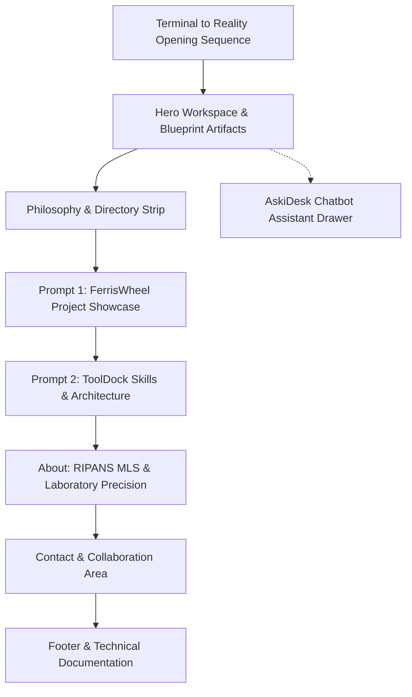

# UI/UX Specification & Editorial Design System

## 1. Executive Summary & Design Direction
The Abhigyan Saikia Portfolio Redesign ("Terminal to Reality") rejects generic developer portfolio tropes — neon glows, floating amorphous blobs, fake matrix rains, and cards-inside-cards templates. It is an editorial digital experience inspired by high-end architectural and industrial design, pairing Swiss typographic discipline with physical software assembly metaphors.

---

## 2. Information Architecture & Page Hierarchy

1. **Header & Navigation**:
   - Wordmark: "ABHIGYAN SAIKIA" (luminous white, uppercase, tracking wide).
   - Navigation links: `Work (#works)`, `Skills (#skills)`, `About (#about)`, `Contact (#contact)`.
   - Interaction mode toggle: Human View vs Agent View (inspect raw LLM context).

2. **The Project Assembly Loader & Hero**:
   - Seamless transformation where the loading sequence and the homepage hero share the exact same 3D spatial scene.
   - The scene features physical blueprint sheets, cropped browser frames, interface panels, and layout bounds assembling into the active portfolio.

3. **Prompt 1: FerrisWheel Project Showcase (`#works`)**:
   - Revolving circular carousel featuring verified projects:
     1. **ToolKB** (`toolkb.in` / first featured project)
     2. **Arogya Relief** (Disaster triage & medical supply platform)
     3. **Motion Subtitle Studio** (Video typography & subtitle synchronizer)
     4. **Brandcey** (Creative service marketplace & design system)
   - Detailed project dossier with live site links, repository links, tech tags, and description.

4. **Prompt 2: ToolDock Interactive Technology Section (`#skills`)**:
   - Magnification dock inspired by precision desktop interfaces.
   - Verified technologies only (React 19, Next.js, TypeScript, Tailwind CSS, Python, Node.js, CSS 3D, Lenis, Vitest).

5. **About: Medical Science & Engineering Rigor (`#about`)**:
   - Contextualizing Abhigyan's dual discipline: Bachelor of Medical Laboratory Science (BSc MLT) at RIPANS combined with full-stack systems engineering.

6. **Contact Section (`#contact`)**:
   - Direct email card (`work@abhigyansaikia.in`) with Animate UI Copy Button.
   - Interactive submission form with Animate UI Liquid Button.
   - Verified location (Assam, India) and social links (GitHub, LinkedIn).

7. **AskiDesk Chatbot Assistant**:
   - Floating launcher in the bottom corner with live indicator.
   - Expandable drawer with session history, suggested queries, and real-time answering.

---

## 3. Viewport & Breakpoint Specifications

| Device Type | Target Resolutions | Layout Adaptation |
| :--- | :--- | :--- |
| **Mobile Compact** | 320px – 375px | 1-column layout, simplified 2D wheel fallback, touch-first tool dock. |
| **Mobile Standard** | 390px × 844px, 430px × 932px | Full touch gestures, auto-wrapping dock, drawer-style chatbot. |
| **Tablet** | 768px × 1024px | 2-column contact grid, medium 3D perspective wheel, dock centered. |
| **Laptop / Desktop** | 1440px × 900px | Full 3D perspective scene, multi-card Ferris wheel, expanded dock. |
| **Ultrawide** | 1920px × 1080px+ | Max-width containment (1440px), balanced whitespace. |
